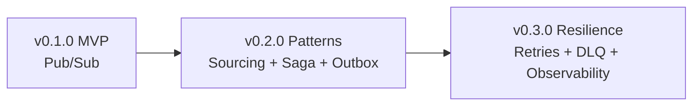

# 🗺 Roadmap — eda-starter

Guía evolutiva del proyecto: fases, patrones, componentes y estado. Objetivo: aprender Event-Driven Architecture implementando un flujo de pedidos (Order) sin dependencias externas (Kafka/RabbitMQ/AWS) — puro TypeScript en memoria.

## Fases

| Fase | Milestone | Estado | Epic |
|------|-----------|--------|------|
| **Phase 0-2** | [v0.1.0 — MVP](https://github.com/pelukron/eda-starter/milestone/1) (due 2026-08-14) | ✅ Completa | [#5](https://github.com/pelukron/eda-starter/issues/5) |
| **Phase 3** | [v0.2.0 — Patterns](https://github.com/pelukron/eda-starter/milestone/2) (due 2026-09-14) | 🚧 En progreso | [#13](https://github.com/pelukron/eda-starter/issues/13) |
| **Phase 4** | v0.3.0 — Resilience | ⏳ Planeada | — |

---

## Phase 0-2 — MVP: Pub/Sub Demo ✅

Bootstrap del repo + dominio base + bus de eventos en memoria.

| Componente | Patrón | Archivo | Issue |
|------------|--------|---------|-------|
| Governance (CI, dependabot, templates) | — | `.github/` | [#6](https://github.com/pelukron/eda-starter/issues/6) ✅ |
| Config Node/TS (pnpm, Biome, Vitest, Husky) | — | `package.json`, `biome.json` | [#7](https://github.com/pelukron/eda-starter/issues/7) ✅ |
| `Event` base + `EventHandler` port | Domain modeling | `src/domain/events/event.ts`, `src/domain/ports/event-handler.ts` | [#8](https://github.com/pelukron/eda-starter/issues/8) ✅ |
| Order flow events | Domain events | `src/domain/events/order-events.ts` | [#10](https://github.com/pelukron/eda-starter/issues/10) ✅ |
| `InMemoryEventBus` (wildcard `*`) | **Pub/Sub** | `src/infrastructure/event-bus/in-memory-event-bus.ts` | [#9](https://github.com/pelukron/eda-starter/issues/9) / [#11](https://github.com/pelukron/eda-starter/issues/11) ✅ |
| Payment/Inventory/Notification handlers | Application layer | `src/application/handlers/` | [#12](https://github.com/pelukron/eda-starter/issues/12) ✅ |

**Resultado:** demo funcional (`pnpm dev`) — `OrderCreated` → Payment → Inventory → Notification (wildcard). 15+ tests.

---

## Phase 3 — Patterns: Sourcing + Saga + Outbox 🚧

Añade persistencia de eventos, orquestación con compensación y publicación confiable.

| Componente | Patrón | Archivo | Issue | Estado |
|------------|--------|---------|-------|--------|
| `InMemoryEventStore` (append-only, streams, subscriptions) | **Event Sourcing** | `src/infrastructure/event-store/in-memory-event-store.ts` | [#14](https://github.com/pelukron/eda-starter/issues/14) | ✅ Completo (PR [#18](https://github.com/pelukron/eda-starter/pull/18)) |
| `OrderSaga` orchestrator + compensación | **Saga** | `src/application/sagas/` (pendiente) | [#15](https://github.com/pelukron/eda-starter/issues/15) | ⏳ Pendiente |
| `TransactionalOutbox` con relay | **Outbox** | `src/infrastructure/outbox/` (pendiente) | [#16](https://github.com/pelukron/eda-starter/issues/16) | ⏳ Pendiente |
| Docs: pattern guides + diagramas actualizados | Documentación | `docs/` (VitePress) | [#17](https://github.com/pelukron/eda-starter/issues/17) | ⏳ Pendiente |

**Por qué estos patrones:**
- **Event Sourcing** — el estado se reconstruye reproduciendo eventos, no se guarda directamente. Útil para auditoría/replay.
- **Saga** — coordina pasos distribuidos (Payment → Inventory → Confirm) con rollback si algo falla (compensación), sin transacciones distribuidas.
- **Outbox** — evita perder eventos si el proceso muere entre escribir el estado y publicar el evento (dual-write problem).

---

## Phase 4 — Resilience (v0.3.0) ⏳ Planeada

No hay issues creados aún. Propuesta de alcance cuando se agote v0.2.0:

| Componente | Patrón | Propósito |
|------------|--------|-----------|
| Retry policy con backoff | Resilience | Reintentar handlers fallidos sin perder el evento |
| Dead Letter Queue (DLQ) | Resilience | Aislar eventos que fallan repetidamente |
| Idempotency keys | Consistency | Evitar procesar el mismo evento dos veces |
| Structured logging / tracing correlación | Observability | Seguir un evento end-to-end por `correlationId` |

---

## Decisiones de diseño

- **Sin infraestructura externa**: todo en memoria (`InMemory*`) — foco en aprender los patrones, no en operar Kafka/RabbitMQ. Migrar a infra real (ej. Redis Streams, Kafka) sería una fase futura opcional, no planeada aquí.
- **Observables vs Promises**: se eligió `Promise` + async iterators sobre RxJS — repo educativo simple, RxJS añade curva de aprendizaje sin beneficio para este alcance (ver `openspec/` para el historial de la decisión).
- **OpenSpec**: usado como historial de decisiones de features pasadas (`openspec/changes/`). **No es framework obligatorio** para nuevas implementaciones — es documentación opcional de contexto, no un requisito de proceso.

## Project Management

- **Epics**: [#5](https://github.com/pelukron/eda-starter/issues/5) (Phase 0-2), [#13](https://github.com/pelukron/eda-starter/issues/13) (Phase 3)
- **Project Board**: [eda-starter Roadmap](https://github.com/users/pelukron/projects/4)
- Convenciones de issues/PRs y tracking cross-session en `.hermes/EPICS_TRACKING.md`.
